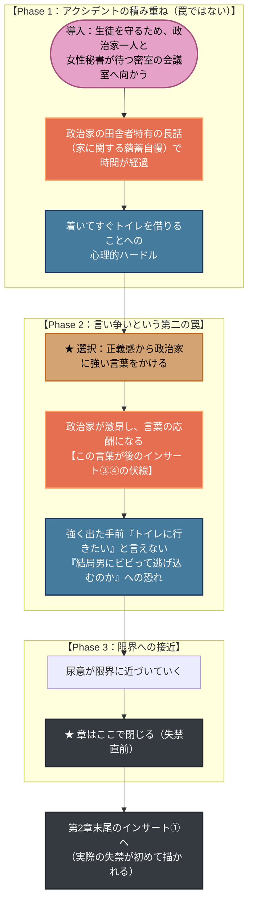

# 🌸 第1章：春 プロットトポロジー（DAG依存関係分析）

本ドキュメントは、第1章（主人公：田邊 桃香）における、**政治家の意図的な罠ではない
アクシデントの積み重ね**が、いかにして失禁寸前まで追い詰めるかを有向非巡回グラフ
（DAG）として体系化したプロット設計書です。

---

## 1. 物語トポロジー依存関係図 (Mermaid)

---

## 2. 物語のトポロジカル進行フェーズ表

| フェーズ | 舞台 | 桃香のアクション／心理 | トポロジー機能 |
| :--- | :--- | :--- | :--- |
| **Phase 1** | 密室の会議室 | 政治家の長話、トイレを借りる心理的ハードル | アクシデントの積み重ね。**意図的な罠ではない**（[[cpt-4f1a]]） |
| **Phase 2** | 同 | 強い言葉→言い争い→トイレに行けなくなる | 「強がりを裏切れない」という心理的自縄自縛（[[cpt-8b3d]]） |
| **Phase 3** | 同 | 尿意が限界に近づく | 章はここで閉じる。破綻本体はインサート①へ持ち越し |

> [!important] この章の言葉が後で効いてくる
> Phase 2でかけた「ある言葉」（**作者指定（2026-10-12）：政治家に向けた「まるで赤ん坊ですね」**）は、第4章末尾のインサート③・第5章前編末尾の④で描かれる
> 政治家・秘書による意趣返し（オムツを履かされる経緯）の引き金になる
> （[[cpt-c7e2]]、[[rules/momoka-warp-engine]]）。
