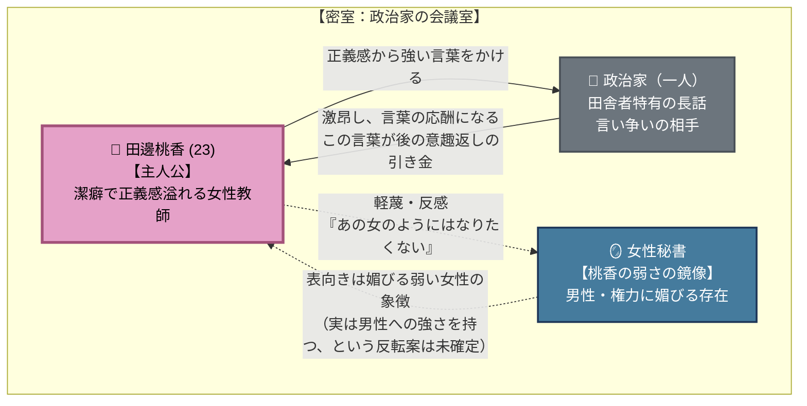

# 🌸 第1章：春 人間関係・心理力学トポロジー

第1章（主人公：田邊 桃香）における**「正義感と言い争い」「秘書という鏡像」**を
有向グラフとして整理した相関図です。

---

## 1. 人間関係・心理力学相関図 (Mermaid)

---

## 2. 心理力学の構造分析

### ① 桃香 ⇄ 政治家（言い争いという第二の罠）

政治家は桃香を意図的に罠にかけようとしていない——長話で時間を浪費させただけの
無自覚な加害者。真の罠は**桃香自身が招いた言い争い**にある。強い言葉で相手を
激昂させたことで、自分から「トイレに行きたい」と言い出す退路を自分で塞いでしまう
（[[cpt-8b3d]]）。

### ② 桃香 ⇄ 女性秘書（弱さの鏡像）

秘書は単なる脇役ではなく、**桃香が最も嫌悪する弱さ（男性・権力への迎合）を体現する
鏡**として確立される（[[cpt-0a9f]]）。この対立の構図が、後の第3・4章末尾のインサート
（[[rules/momoka-warp-engine]]）で秘書が桃香を追い詰める側に回ったときの落差を
支える。「秘書の方が実は男性への強さを持っている」という反転案は未確定。
