# ☀️ 第2章：夏 プロットトポロジー（DAG依存関係分析）

本ドキュメントは、第2章「夏」（金城 向日葵）の物語展開、選択、環境トラップ、心理的拘束条件（心理的ロック）を有向非巡回グラフ（DAG / トポロジカル構造）として体系化したプロット設計書です。

---

## 1. 物語トポロジー依存関係図 (Mermaid)

```mermaid
flowchart TD
    classDef situation fill:#2a9d8f,stroke:#264653,stroke-width:2px,color:#fff;
    classDef choice fill:#d4a373,stroke:#bc6c25,stroke-width:2px,color:#000;
    classDef trap fill:#e76f51,stroke:#f4a261,stroke-width:2px,color:#fff;
    classDef psychLock fill:#457b9d,stroke:#1d3557,stroke-width:2px,color:#fff;
    classDef climax fill:#e63946,stroke:#9b2226,stroke-width:2px,color:#fff;
    classDef endBeat fill:#6a0dad,stroke:#3c096c,stroke-width:2px,color:#fff;

    Start(["導入：夏休みの屋上プール<br/>(TikTok撮影のために来ている / うたた寝)"]):::situation

    %% ==========================================
    %% Phase 1: 屋上の拘束と最初の決断
    %% ==========================================
    subgraph Phase1_Rooftop ["【Phase 1：拗ねと、悪意と、計画】"]
        Start --> Sulk["拗ね：唯香が友達を連れてアイスを買いに行く<br/>→ 幼稚に拗ねて寝たふり（一人目の足音）"]:::choice
        Sulk --> SecondStep["二人目の気配（場面としては書かない）<br/>後から『誰か来た気がする』という記憶だけ"]
        Sulk --> GoodWill1["善意①：唯香たちがタオルと荷物を教室へ運ぶ"]:::trap

        SecondStep --> LockPrank["悪戯：水着の肩紐とフェンスの金網が南京錠で固定<br/>(犯人不明・脱衣は想定されていない)"]:::trap
        LockPrank --> OnePoint["一点／全裸：上下一体の競泳型・結び目なし<br/>【たった一点の拘束が全裸化を要求する】"]:::trap
        GoodWill1 --> NoTowel["覆えるものが一つもない<br/>(手元にあるのはスマホと紐付きボトルのみ)"]:::trap

        OnePoint & NoTowel --> ChoicePride["★ 選択①：助けを呼べるのに呼ばない<br/>【優雅な復讐のプロット：何食わぬ顔で現れてみせる】"]:::choice
        ChoicePride --> UrinationPressure1["生理的限界（尿意）の切迫"]
        UrinationPressure1 --> ChoiceNude["★ 選択②：水着を脱ぎ捨てる<br/>【不可逆フラグ：全裸化】"]:::choice
    end

    %% ==========================================
    %% Phase 2: 道行き（1分に満たない距離）
    %% ==========================================
    subgraph Phase2_Journey ["【Phase 2：道行き — 物理的に1分、心理的に長い】"]
        ChoiceNude --> Landing["階段の踊り場<br/>【上下両方から同時に隠れることはできない】<br/>(一瞬、誰かに見られたかもしれない)"]:::trap
        Landing --> EmptyRoom["視聴覚室は無人 — 章で唯一のリリーフ"]
        EmptyRoom --> Trace["人がいた形跡：机の上の漫画<br/>(持ち主はまだ明かさない)"]:::trap
    end

    %% ==========================================
    %% Phase 3: 逃げ場の消滅
    %% ==========================================
    subgraph Phase3_Lockdown ["【Phase 3：逃げ場の消滅（遮蔽の反転）】"]
        Trace --> Dilemma["★ ジレンマ：留まって服を探すか、女子トイレへ逃げるか"]:::choice
        Dilemma --> GoodWill2["善意②：服がない<br/>(唯香たちが『下着が見つかっては』と棚へ移していた)"]:::trap
        GoodWill2 --> Footsteps["引き返そうとした瞬間、生徒たちの足音<br/>【退路の消滅】"]:::trap
        Footsteps --> ChoiceCurtain["★ 選択：カーテン裏へ潜入"]:::choice

        ChoiceCurtain --> Ledge["窓枠の桟に爪先立ち<br/>(足を下ろせばカーテンからはみ出す)"]:::trap
        Ledge --> TrapGlass["窓ガラスに身体前面を密着<br/>【構造的アイロニー：校庭側から前面が完全露出】"]:::trap
        TrapGlass --> CrowdGaze["群衆の視線（顔をガラスに押し付けているため直接見えない）"]
    end

    %% ==========================================
    %% Phase 4: 遅れてくる露見
    %% ==========================================
    subgraph Phase4_Reveal ["【Phase 4：遅れてくる露見】"]
        CrowdGaze --> BareFeet["教室側が気づくのはカーテン下の素足だけ<br/>【男女すら分からない — 読者だけが知っている】"]:::trap
        BareFeet --> Broom["素手が届かない高さ → 唯一届く物は箒<br/>(道具越しの干渉／誰も確信を持っていない)"]:::trap
        Broom --> Reveal["★ 判明（同時多発）：下着の正体／手の爪／直接目撃<br/>【それまでの言葉が遡って別の意味に変わる】"]:::climax

        Reveal --> SeeYuika["野次馬の中に唯香の顔<br/>ガラス越しに助けを求め、同時に責める"]:::psychLock
        SeeYuika --> Kouhai["唯香の答えの中にだけ現れる後輩<br/>『何とも言えない顔』『忘れちゃった』"]

        ChoiceCurtain --> PsychLock1["心理的ロック①：動けば教室全体へ全身露出"]:::psychLock
        Reveal --> PsychLock2["心理的ロック②：教室に奥津がいる<br/>(彼にだけは見られたくない)"]:::psychLock

        PsychLock1 & PsychLock2 & Kouhai --> CompleteFreeze["【選択肢ゼロ：完全フリーズ・身動き不能】"]
    end

    %% ==========================================
    %% Phase 5: 決壊と、その1秒先
    %% ==========================================
    subgraph Phase5_Catastrophe ["【Phase 5：決壊と、その1秒先】"]
        CompleteFreeze --> YuikaHand["唯香がガラス越しに手で覆う<br/>【守られることが、内面を暴く】"]:::psychLock
        YuikaHand --> ClimaxBreakdown["★ クライマックス：全員の前で決壊<br/>ほとんど全員がスマホを向ける"]:::climax

        ClimaxBreakdown --> Coffee["陽光に輝く尿が、こぼれたコーヒーに濁されていく<br/>(境界がめらめらと踊る)"]
        ClimaxBreakdown --> FinalBeat["★ 最終ビート：極限の抗いの果ての諦念<br/>『もう全部見られちゃえばいいんだ』"]:::endBeat
        FinalBeat --> Coda["★ 幕引き：尿が奥津の椅子へ近づいていく<br/>【諦めきることすら許されない — 発覚は間近】"]:::endBeat
    end
```

---

## 2. 物語のトポロジカル進行フェーズ表

| フェーズ | 舞台 | 主人公のアクション / 事象 | ロック＆キー・トポロジー機能 |
| :--- | :--- | :--- | :--- |
| **Phase 1** | 屋上のプール | ・拗ねて寝たふり（一人目＝唯香）／二人目の気配 ・善意でタオルと荷物が運び去られる ・**肩紐一点**が金網と南京錠で固定される ・**助けを呼べるのに呼ばない**（優雅な復讐） ・尿意の限界から**水着を脱ぎ捨てて脱出** | **不可逆フラグ（全裸化）の起動** 「一点の拘束／全裸の代償」という非対称。 **呼べる助けを呼ばないという能動的選択**が破滅を駆動する |
| **Phase 2** | 階段・踊り場・視聴覚室 | ・**踊り場**で女子生徒をやり過ごす ・無人の部屋＝章で唯一のリリーフ ・机の上に**漫画**（人がいた形跡） | **カーテン裏の予告編** 上下同時に隠れられない踊り場が、後の「教室側／校庭側」を小規模で先取りする |
| **Phase 3** | 視聴覚室・窓際 | ・**留まるか女子トイレか**のジレンマ ・善意で移された荷物のせいで服が見つからない ・足音で退路が消え、**カーテン裏へ** ・**窓枠の桟に爪先立ち**／前面が校庭側へ露出 | **空間トポロジーの表裏反転** （隠れるための遮蔽物が、外部への最大露出装置へと機能反転） **爪先立ちは姿勢そのものが時間制限になる** |
| **Phase 4** | カーテン裏 | ・教室側は**素足しか見ておらず男女も不明** ・素手が届かず、**箒だけが届く** ・**判明は同時多発**（下着／爪／直接目撃） ・唯香にガラス越しに助けを求め、責める | **心理的ロック（脱出パスの消滅）** 判明が**遡及的に**それまでの言葉の意味を変える。 身体の露出と同時に「内面の醜さ」が露出 |
| **Phase 5** | 決壊〜結末 | ・**唯香がガラス越しに手で覆う** ・全員の前で決壊、ほとんどがスマホを向ける ・尿とコーヒーが混じり、境界が踊る ・諦念、そして**尿が奥津の椅子へ近づく** | **破綻のピークと、閉じない幕引き** 諦念に達してなお守りたいものが残り、それが手の届かない速度で侵されていく |

---

## 3. 物語脚本としての構造的強度

1. **主人公の能動的選択が破滅を加速する（古典悲劇的DAG）**
   - 受動的に被害に遭うだけでなく、「漏らしたくないから脱ぐ」「隠れたいからカーテンに入る」という**その瞬間における最善の選択が、不可逆な罠を次々と連鎖させていく**無駄のない一本道構造です。
   - **最上流にあるのは尿意ではなくプライド。**「助けを呼べるのに呼ばない」という選択（優雅な復讐のプロット）が全ての前提であり、彼女は逃げているのではなく**計画を実行している**。だから計画が崩れるたびに失うのは安全ではなく**演出**になります。
   - **女子トイレという正解が、最後まで見えているのに選ばれない。** 読者はこの分岐を覚えているため、決壊の瞬間に必ず「あのとき行っていれば」を思い出します。

2. **多重レイヤーの「露出」（身体・社会・内面）**
   - 身体の露出（校庭側への前面露出）
   - 社会的立場の露出（満席の教室・片想いの相手・学校全体への公然化）
   - 内面の露出（天真爛漫な人気者が抱える親友への後ろ暗い猜疑心）
   これら3つの露出が「カーテン裏のフリーズ」という1点に収束し、クライマックスへ直結しています。

3. **退路を塞ぐノードが、ほぼすべて「善意」である**
   - タオルの消失、服の不在、下着の露見——DAG上で最も致命的な三つのトラップは、**唯香たちの親切から発生**しています。明確な悪意のノードは**南京錠ただ一つ**しかありません。
   - この構造が「憎むべき相手が与えられない」という第2章固有の性質を、心理説明ではなく**因果グラフの形**で成立させています。

4. **建築がエスカレーションの経路を用意する**
   - 教室側の干渉は「誰かが決断した」順ではなく、**手が届くようになった順**に起きます（素手では届かない高さ → 箒 → 段を上る）。
   - 加害の意思決定を誰も引き受けないまま被害だけが進行する——これも同じ「加害者の不在」の変奏です。

5. **終端ノードが閉じていない**
   - 通常の破綻章は「決壊 → 諦念」で閉じますが、第2章は**その後に一本だけ辺が伸びます**（尿が奥津の椅子へ近づく）。
   - 諦念に達した人物に、まだ一つだけ守りたいものが残っている。**終端が確定しないまま章が閉じる**ことが、直後のインサート①（桃香／「1秒先が怖い」）へそのまま接続します。
