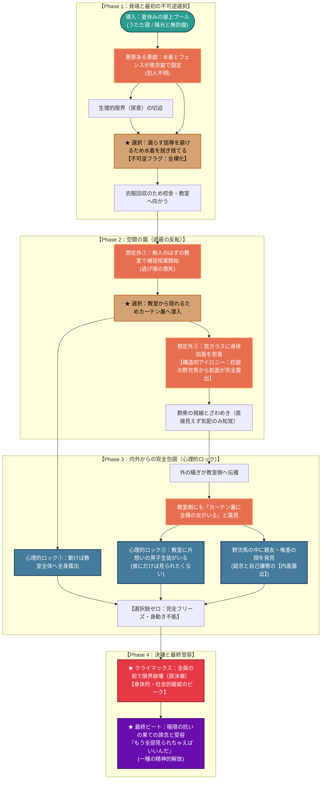

# ☀️ 第2章：夏 プロットトポロジー（DAG依存関係分析）

本ドキュメントは、第2章「夏」（金城 向日葵）の物語展開、選択、環境トラップ、心理的拘束条件（心理的ロック）を有向非巡回グラフ（DAG / トポロジカル構造）として体系化したプロット設計書です。

---

## 1. 物語トポロジー依存関係図 (Mermaid)

---

## 2. 物語のトポロジカル進行フェーズ表

| フェーズ | 舞台 | 主人公のアクション / 事象 | ロック＆キー・トポロジー機能 |
| :--- | :--- | :--- | :--- |
| **Phase 1** | 屋上のプール | ・悪戯でフェンスに南京錠で水着を拘束される ・尿意の限界から、**水着を脱ぎ捨てて脱出**する | **不可逆フラグ（全裸化）の起動** （恥を回避するための合理的選択が次の罠の前提に） |
| **Phase 2** | 教室・窓際 | ・無人のはずが無数の生徒が集まる補習授業が開始 ・隠れるため**カーテン裏に潜入し窓ガラスに密着** ・**校庭側の野次馬から前面が完全露出** | **空間トポロジーの表裏反転** （隠れるための遮蔽物が、外部への最大露出装置へと機能反転） |
| **Phase 3** | カーテン裏 | ・外の騒ぎが教室側へ伝わり内外から包囲される ・野次馬の中に親友・唯香の顔を発見 ・**「動けば教室へ露出」「片想いの男子がいる」** | **心理的ロック（脱出パスの消滅）** 身体の露出と同時に親友を疑う「内面の醜さ」が露出 |
| **Phase 4** | 決壊〜結末 | ・逃げ場のない極限状態での尿崩壊 ・極限の抗いの果てに訪れる「諦念と受容」 | **破綻のピークと精神的解放** |

---

## 3. 物語脚本としての構造的強度

1. **主人公の能動的選択が破滅を加速する（古典悲劇的DAG）**
   - 受動的に被害に遭うだけでなく、「漏らしたくないから脱ぐ」「隠れたいからカーテンに入る」という**その瞬間における最善の選択が、不可逆な罠を次々と連鎖させていく**無駄のない一本道構造です。

2. **多重レイヤーの「露出」（身体・社会・内面）**
   - 身体の露出（校庭側への前面露出）
   - 社会的立場の露出（満席の教室・片想いの相手・学校全体への公然化）
   - 内面の露出（天真爛漫な人気者が抱える親友への後ろ暗い猜疑心）
   これら3つの露出が「カーテン裏のフリーズ」という1点に収束し、クライマックスへ直結しています。
