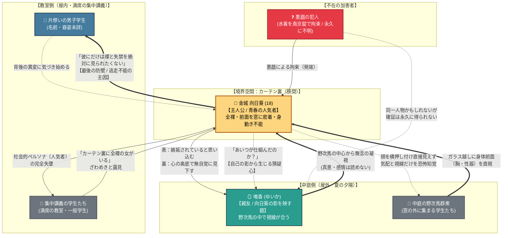

# ☀️ 第2章：夏 人間関係・心理力学トポロジー

第2章「夏」（主人公：金城 向日葵）における登場人物間の**「心理的力学（好意・見下し・猜疑心）」「視線の非対称性」「空間の境界（カーテン・窓ガラス）」**を有向グラフとして整理した関係図です。

---

## 1. 人間関係・視線力学相関図 (Mermaid)

---

## 2. 人間関係の多重レイヤー分析

### ① 向日葵 ⇄ 片想いの男子学生（最後の心理防壁）
- **関係性**: 向日葵の一方的な思慕（人物詳細は未詳）。
- **力学機能**: 向日葵がカーテンから飛び出して逃げられない**最大の心理的拘束アンカー**。
- **ドラマツルギー**: 「全世界に裸を見られても、この一人にだけは見られたくない」という執着が、皮肉にも全世界（中庭・教室）への露出時間を限界まで引き延ばし、最も屈辱的な決壊へと追い詰めます。

### ② 向日葵 ⇄ 唯香（自己の影を映す二重構造）
- **関係性**: 幼馴染・親友でありながら、向日葵が「心の奥底で見下している」相手。
- **力学機能**: 身体の露出と同時に**「向日葵の内面の醜さ（後ろ暗い侮り）」を露出させる装置**。
- **二重の宙吊り（解決されない葛藤）**:

  | 可能性 | 破綻時の心理的意味 |
  | --- | --- |
  | **唯香が犯人の場合** | 罠に嵌められたこと、見下していた相手への「完全な敗北」 |
  | **唯香が犯人でない場合** | 親友を勝手に疑った「自分自身の醜悪さ」を抱えたまま、その相手に裸を見られる屈辱 |
  *※犯人が最後まで明かされないため、向日葵はこの両方の地獄を同時に抱え続けることになります。*

### ③ 向日葵 ⇄ 外部視線（中庭野次馬 ＆ 教室学生）
- **視線の非対称性**:
  - **中庭側（前面）**: 肉体（性的パーツ）がガラスに圧迫され艶かしく露出。向日葵側からは群衆の顔を直接見られず、視線の気配のみを強烈に知覚。
  - **教室側（背面）**: 社会的立場（人気者としての日常）が崩壊していく場。
- **二重包囲**: 内外からの視線に挟み撃ちにされることで、向日葵の自己同一性（ペルソナ）が粉々に粉砕されます。
