# 🍂 第3章：秋 プロットトポロジー（DAG依存関係分析）

本ドキュメントは、第3章「秋」（主人公：遠山 楓／視点：高木 圭）における物語展開、自滅的譲歩、非対称な感情の着火、および支配権の不可逆な反転を有向非巡回グラフ（DAG / トポロジカル構造）として体系化したプロット設計書です。

---

## 1. 物語トポロジー依存関係図 (Mermaid)

```mermaid
flowchart TD
    classDef situation fill:#812E2A,stroke:#4a1512,stroke-width:2px,color:#fff;
    classDef choice fill:#d4a373,stroke:#bc6c25,stroke-width:2px,color:#000;
    classDef trap fill:#e76f51,stroke:#f4a261,stroke-width:2px,color:#fff;
    classDef psychLock fill:#457b9d,stroke:#1d3557,stroke-width:2px,color:#fff;
    classDef climax fill:#e63946,stroke:#9b2226,stroke-width:2px,color:#fff;
    classDef endBeat fill:#343a40,stroke:#212529,stroke-width:2px,color:#fff;

    Start(["導入：完璧な総合職としての日常<br/>(社内孤立 / スキのないペルソナ)"]):::situation

    %% ==========================================
    %% Phase 1: 漏濁の発端と三層の自壊
    %% ==========================================
    subgraph Phase1_Breakdown ["【Phase 1：発端と三層の自壊】"]
        Start --> IncidentMud["社内キャンプ場：予期せぬ漏濁の発生"]:::trap
        IncidentMud --> WitnessTakagi["後輩・高木圭に目撃される<br/>【不可逆フラグ：秘密の共有】"]:::trap
        
        WitnessTakagi --> Layer1_Isolation["三層の自壊①【孤立】：社内に助けを呼べる味方が皆無"]:::psychLock
        Layer1_Isolation --> Layer2_Guilt["三層の自壊②【罪悪感】：体面維持のため欠勤理由を高木のせいにする"]:::psychLock
        Layer2_Guilt --> Layer3_Concession["三層の自壊③【自らの譲歩】：個室から出られず下着・服の洗濯を高木に指示"]:::choice
    end

    %% ==========================================
    %% Phase 2: 非対称な着弾と支配権の反転
    %% ==========================================
    subgraph Phase2_Reversal ["【Phase 2：侮辱の着火と無言の強制】"]
        Layer3_Concession --> AsymmetricImpact["非対称な着弾：楓の『最大限の譲歩』が<br/>高木には『男として見られていない侮辱』となる"]:::psychLock
        AsymmetricImpact --> TakagiRevenge["高木の復讐心に点火（支配関係の逆転開始）"]:::trap
        
        TakagiRevenge --> BlockDress["高木がある手でワンピース着用を封鎖"]:::trap
        BlockDress --> ForceThinShirt["下半身無防備・薄手シャツ1枚での屋外移動を余儀なくされる"]:::choice
    end

    %% ==========================================
    %% Phase 3: 恥辱の極致（クライマックス）
    %% ==========================================
    subgraph Phase3_Climax ["【Phase 3：敵対宣言と身体的絶対屈服】"]
        ForceThinShirt --> ProvocationCrotch["高木の挑発：クロッチの染みを見咎め<br/>『先輩はお尻の拭き方も知らないんですか？』<br/>【明確な敵対・決別の宣言】"]:::climax
        
        ProvocationCrotch --> ReachCar["屋外を歩かされ駐車場・高木の車へ到達"]
        ReachCar --> LockFromInside["高木が車を内側から施錠<br/>『汚い尻で座席に座らないでくれ』"]:::trap
        
        LockFromInside --> ChoiceWipe["★ 究極の受容：車に乗る条件として<br/>肛門を露出し高木にウェットティッシュで拭かれる"]:::climax
    end

    %% ==========================================
    %% Phase 4: 事務的な終焉
    %% ==========================================
    subgraph Phase4_Aftermath ["【Phase 4：冷厳な断絶】"]
        ChoiceWipe --> Resignation["楓は適応せず退職（出社拒否）"]
        Resignation --> SeatTakeover["高木が楓の席（ポジション）に座る"]:::endBeat
        SeatTakeover --> EternalMemory["和解も破局もなく関係断絶<br/>高木の心に永遠に消えない記憶として沈殿"]:::endBeat
    end
```

---

## 2. 物語のトポロジカル進行フェーズ表

| フェーズ | 舞台 | 主人公（楓）／視点（高木）の動態 | トポロジー・支配構造の機能 |
| :--- | :--- | :--- | :--- |
| **Phase 1** | キャンプ場 | ・漏濁を高木に目撃される ・孤立と体面から「下着を洗わせる」自滅的譲歩を選択 | **不可逆フラグ（秘密の非対称保有）の発生** 自ら退路を断つ指示 |
| **Phase 2** | 洗面所〜屋外 | ・楓の譲歩が高木への侮辱として着火 ・高木が衣服の選択肢を封じ、薄手シャツ1枚で屋外を歩かせる | **支配権の完全反転（無言の強制）** 直接命令せず環境で服従させる |
| **Phase 3** | 車・駐車場 | ・クロッチへの言及による敵対の顕在化 ・車内施錠と「尻拭き」要求の受容 | **絶対的屈辱の合意受容（クライマックス）** 鍵を持つ高木への全面降伏 |
| **Phase 4** | オフィス | ・楓の退職と高木の昇格（席の継承） ・感情的な劇化を排した事務的断絶 | **冷厳な事後処理と記憶の永続化** |
