# 🍂 第3章：秋 プロットトポロジー（DAG依存関係分析）

本ドキュメントは、第3章「秋」（主人公：遠山 楓／視点：高木 圭）における物語展開、自滅的譲歩、非対称な感情の着火、および支配権の不可逆な反転を有向非巡回グラフ（DAG / トポロジカル構造）として体系化したプロット設計書です。

> [!info] 全面改訂（2026-08-23）
> 舞台（社内キャンプ場 → 出張の道中に紛れ込んだ寂れた自然公園）、職業（大手企業総合職 → 地方公務員）、
> 高木の身分（インターン → 採用試験に落ちたアルバイト）、破綻面（泥 → タイル）、
> ワンピースの封鎖手段（未詳 → 公用車への施錠）、結末（席の継承 → セーターの返却）が
> すべて改訂されたため、旧版のグラフは破棄して作り直している。

---

## 1. 物語トポロジー依存関係図 (Mermaid)

```mermaid
flowchart TD
    classDef situation fill:#812E2A,stroke:#4a1512,stroke-width:2px,color:#fff;
    classDef choice fill:#d4a373,stroke:#bc6c25,stroke-width:2px,color:#000;
    classDef trap fill:#e76f51,stroke:#f4a261,stroke-width:2px,color:#fff;
    classDef psychLock fill:#457b9d,stroke:#1d3557,stroke-width:2px,color:#fff;
    classDef past fill:#9F9085,stroke:#523D2C,stroke-width:2px,color:#000;
    classDef climax fill:#e63946,stroke:#9b2226,stroke-width:2px,color:#fff;
    classDef endBeat fill:#343a40,stroke:#212529,stroke-width:2px,color:#fff;

    Start(["導入：完璧な公務員としての日常<br/>(庁舎で一人だけ都会的に装う＝孤立の可視化)"]):::situation

    %% ==========================================
    %% Phase 0: 前史（回想として配置される）
    %% ==========================================
    subgraph Phase0_Past ["【Phase 0：前史 — 章の中では回想として現れる】"]
        PastNote["付箋：『自分のお尻は自分で拭いてね』<br/>(楓は書いたことを覚えていない)"]:::past
        PastPublic["『公用物を私物化するな』"]:::past
        PastRedo["仕事を信用せず、目の前でやり直させた"]:::past
        PastSweater["高木が楓の好みを研究して買ったセーター<br/>→ 遠回しに『ダサい』と否定される"]:::past
        PastBag["楓は高木の趣味の物を鞄に入れて持ち歩いている<br/>(彼の趣味を『幼稚』といじりながら)"]:::past
    end

    %% ==========================================
    %% Phase 1: 道行き（三度の遅延）
    %% ==========================================
    subgraph Phase1_Drive ["【Phase 1：道行き — 遅延を作るのは毎回、楓のプライド】"]
        Start --> Survey["固定資産税の土地調査<br/>公用車で海沿いの遠地へ（二人きり）"]
        Survey --> Delay1["遅延①：重要でないふりをしてPAを促す<br/>→ 高木が行き過ぎる"]:::trap
        Delay1 --> Delay2["遅延②：『コーヒーが』『空気が』と仄めかす<br/>→ 鈍い高木に通じない"]:::trap
        Delay2 --> Confess["余裕ぶりつつ『お手洗いに行きたい』と告白<br/>(耳がピンクに染まる)"]:::choice
        Confess --> SignBoard["案内表示を見た高木が提案 → 山道で迷う<br/>(看板からの距離を確認していなかった)"]:::trap
        SignBoard --> Delay3["遅延③：駐車場所を探してもたつく高木に<br/>『先に降ろして』と言えない"]:::trap
    end

    %% ==========================================
    %% Phase 2: 決壊
    %% ==========================================
    subgraph Phase2_Collapse ["【Phase 2：決壊 — 泥ではなくタイルの上で】"]
        Delay3 --> RunOut["車を飛び出し、分かれ道のある山道を走る"]:::choice
        RunOut --> ToiletBlock["男女共用のトイレ棟を発見（電話ボックス二つ分）"]
        ToiletBlock --> Collapse["★ 決壊：トイレ棟の目前、タイルの上<br/>【あと数歩だった距離が、広がる跡と一緒に画に入る】"]:::climax
        Collapse --> Traces["泥は吸うが、タイルは吸わない<br/>床に広がる跡／尻から跳ねる軌跡"]:::trap
        Traces --> BehindView["高木は後ろから見ている＝顔が見えない<br/>【一生忘れないのは表情ではなく背中と床】"]:::psychLock
    end

    %% ==========================================
    %% Phase 3: 個室（一枚ずつ失われる）
    %% ==========================================
    subgraph Phase3_Stall ["【Phase 3：個室 — 四枚が独立した理由で失われる】"]
        BehindView --> Stall["個室へ。誰もいなくても、なるべく着ていたい"]:::psychLock
        Stall --> L1["ワンピース：自分から洗うよう渡す"]:::choice
        Stall --> L2["パンティストッキング：腰から一体で下だけ脱げない"]:::trap
        Stall --> L3["ショーツ：言うまでもなく"]:::trap
        Stall --> L4["カップ付きキャミ：ロング丈の裾が真っ先に尿を受けた"]:::trap
        L4 --> Hesitation["★ ためらい：脱げば上半身に何も残らない<br/>【カップ一体＝ブラだけ残すことができない】"]:::psychLock
        Hesitation --> Smell["滞留を破るのは匂い（誰にも急かされない）"]:::choice
        Smell --> Naked["全裸。濡れているため座れず、壁にも背をつけられず、立ち続ける"]:::climax
        Hesitation -.->|"外からは音と時間しか分からない<br/>布の音が止む／水が出ない／長すぎる沈黙"| BehindView
    end

    %% ==========================================
    %% Phase 4: 洗面所（点火と封鎖）
    %% ==========================================
    subgraph Phase4_Ignition ["【Phase 4：洗面所 — 点火と、鍵による封鎖】"]
        Naked --> PhoneCall["遅れの連絡をこちらから入れる：高木が自分の携帯を扉の下から差し入れる<br/>外部への唯一の回線は高木の手の中。通話は全部聞こえている<br/>楓は失禁を隠し『高木が迷ったため』と説明する（嘘ではないが本当でもない）"]:::psychLock
        PhoneCall --> Wash["高木が洗う役を負う"]
        Wash --> Delay4["わざとすぐには洗わない<br/>(まだアンモニアの立たない汚れを嗅ぐ)"]:::trap
        Delay4 --> Stain["決定打：便の染み<br/>【尿は事故で済むが、染みは日常の不完全さの証拠】"]:::climax
        Stain --> Disillusion["幻滅 → 形のない反感（本人はまだ復讐と自覚しない）"]:::psychLock
        PastNote -.->|"記憶が上がってくる"| Disillusion

        Disillusion --> OverWash["ワンピースを全体まで水に沈めて洗う<br/>『よく分からなくて、全部洗っちゃいました』<br/>【最初の逸脱：命じられた以上のことをする】"]:::trap
        OverWash --> LockCar["★ ワンピースを公用車に仕舞い、施錠する<br/>【封じているのは説得ではなく鍵】"]:::trap
        PastPublic -.->|"口実として引用される"| LockCar
        LockCar --> JacketOffer["高木が形式的にジャケットを申し出る"]:::choice
        JacketOffer --> RefuseJacket["楓が断る『あなたのスーツを汚すわけには』<br/>【丈のある選択肢が、彼女自身の手で消える】"]:::psychLock
    end

    %% ==========================================
    %% Phase 5: 移動（前と後ろ）
    %% ==========================================
    subgraph Phase5_Walk ["【Phase 5：移動 — どちらを選んでも誰かに見られる】"]
        RefuseJacket --> Offer["高木が着ていたセーターを脱いで差し出す<br/>『それ、まだ濡れてますよね。僕ので良ければ』"]:::choice
        Offer --> NoCami["借り物の下に濡れた物は着られない<br/>【最後の一枚を、彼女自身が手放す】"]:::psychLock
        PastSweater -.->|"否定された物が、否定した本人を覆う"| Offer

        NoCami --> Walk["セーター一枚で屋外を歩く"]:::climax
        Walk --> Dilemma["★ 丈が足りない：前を隠せば後ろが、後ろを隠せば前が出る<br/>【前＝遠くの人影／後ろ＝高木】"]:::climax
        Dilemma --> Cling["加害者から借りた服に縋りつく<br/>抵抗するほど借り物にしがみつくことになる"]:::psychLock

        Walk --> BagOpen["鞄を開ける（予備のストッキングを取るため）"]:::trap
        PastBag -.-> BagOpen
        BagOpen --> Mirror["★ 高木が中身を見る<br/>【自分と同じ行為だと気づく＝鏡像の成立】"]:::climax
        Mirror --> NoProof["だが確証はない。確かめる手段も永久にない<br/>【手に入るのは答えのない問いだけ】"]:::psychLock
    end

    %% ==========================================
    %% Phase 6: 車の前（恥辱の極致）
    %% ==========================================
    subgraph Phase6_Climax ["【Phase 6：車の前 — 比喩が物として返る】"]
        Cling --> ReachCar["車に到達。鍵は最初から高木が持っている"]
        ReachCar --> LockInside["『汚い尻で座席に座らないでくれ』"]:::trap
        LockInside --> FakeLeave["車をのろのろ発進させ、置いていくふりをする<br/>【実際には置いていけない：置けば高木自身が終わる】"]:::trap
        FakeLeave --> WipeChoice
        LockInside --> WipeChoice["★ 乗車の条件として、肛門を露出し拭かれる"]:::climax
        PastNote -.->|"『自分のお尻は自分で拭いてね』の実行"| WipeChoice
        PastRedo -.->|"物陰で拭くことも許されない"| WipeChoice
        WipeChoice --> Collect["拭いた物を楓自身に回収させる<br/>口実は『市営の公園を汚さない』<br/>【公物を汚さないが、規模を変えて二度目】"]:::climax
    end

    %% ==========================================
    %% Phase 7: 断絶
    %% ==========================================
    subgraph Phase7_Aftermath ["【Phase 7：断絶 — 確かめられないまま終わる】"]
        Collect --> Resign["楓は適応せず、出勤しなくなり退職"]:::endBeat
        Resign --> Seat["高木は次の採用試験に受かり、彼女の抜けた席を継ぐ<br/>(逆転劇は主眼ではない)"]:::endBeat
        Seat --> Return["★ 最終ビート：セーターは返される<br/>ただし二人は二度と顔を合わせない"]:::endBeat
        Return --> Perform["楓は高木のいない時間を調べて挨拶に来る<br/>土産を置く＝『立ち直った私』という情報"]:::endBeat
        Perform --> Unknowable["高木は人づてに聞くだけ。深く尋ねれば関心がバレる<br/>【強がりの真偽は最後まで誰にも分からない】"]:::endBeat
    end
```

---

## 2. 物語のトポロジカル進行フェーズ表

| フェーズ | 舞台 | 楓の動態 | 高木の状態 | トポロジー機能 |
| :--- | :--- | :--- | :--- | :--- |
| **Phase 0** | 職場（回想） | 付箋を書く／公物の一言／目の前でやり直させる／セーターを否定する | 傷を受け、根に持つ。同時に彼女の好みを研究している | **後の全加害の引用元**が先に置かれる |
| **Phase 1** | 公用車・海沿いの道 | 三度、本当のことを言わずに機会を潰す | 鈍い。悪意はない | **遅延の原因が毎回プライド**という一本道 |
| **Phase 2** | 自然公園・トイレ棟前 | あと数歩で決壊 | 背後で目撃。「見てしまった」段階 | **痕跡の残る床**＋顔の見えない配置 |
| **Phase 3** | 個室 | 四枚を一枚ずつ失い、全裸で立ち続ける | 外にいる。音と時間しか分からない | **視点の制約が描写手段になる** |
| **Phase 4** | 洗面所 | 洗濯を自分から指示する | わざと洗わない→便の染み→**幻滅**→形のない反感 | **点火**と、**鍵による封鎖** |
| **Phase 5** | 屋外（車まで） | セーター一枚。前後どちらかを必ず晒す | 常に後ろ。鞄の中身を見る | **支配が物を経由して完成**／鏡像の成立 |
| **Phase 6** | 車の前 | 乗車の条件を受け入れ、拭いた物まで回収する | 一度も命令しない。引用するだけ | **比喩の実体化＝因果の完成** |
| **Phase 7** | 職場・その後 | 退職。最後に一度だけ演じてみせる | 席を継ぐ。何も確かめられない | **確かめられないまま断絶する** |

---

## 3. 物語脚本としての構造的強度

### ① 加害の全部が「引用」でできている
高木は**新しい要求を一つも作らない**。彼がすることは、楓が過去に発した言葉・掲げた規範を、そのまま適用することだけです。

* 「自分のお尻は自分で拭いてね」（付箋）→ 車の前で拭かせる
* 「公用物を私物化するな」→ 濡れた服で公用車を汚させない＝**服を車に施錠する**
* 同じ理屈の二度目 → 拭いた物を**市営の公園に捨てさせない＝本人に回収させる**
* 「目の前でやり直させた」過去 → **物陰で拭くことを許さない**根拠になる

**命じる必要がないため、「一度も直接命令しない」という支配の形が、性格ではなく方法として成立します。** そして楓は、自分の言葉で裸にされながら、その事実を最後まで知りません。

### ② 封じているのは説得ではなく、鍵である
「濡れたワンピースを着る」という逃げ道は、**物理的に**塞がれます（公用車への施錠）。口実は楓が受け入れるための体裁にすぎません。

**説得で塞ごうとすると必ず天秤が合わなくなる**——服が台無しになることと半裸で歩くことを比べたら、誰も服を選ばないからです。**塞ぐのは物理、口実は体裁**という分業が、この章のリアリティを支えています。

そして残った選択肢（ジャケット）は、**楓自身が断る**ことで消えます。高木は差し出して、断られただけです。

**通報できない理由**は三つに分かれます。携帯が車内にあり、通報には半裸で誰かに頼るしかない（物理）。置いていかれる恐怖（ふりだが、確かめられない）。そして前半、高木が対立も危うい要求も表向きにしなかったため、「加害だ」と言える瞬間がなく、すべてが彼女自身の選択として積み上がっていること（順序）。電話は点火より前で助けを求める理由がなく、加害が始まってからは回線がない。事後に通報しないのは、失禁と拭かれたことを自分の口で説明しなければならず、聞く相手もいない孤立した職場だからである。

### ③ 選択が反復されるジレンマ
Phase 5 の移動は、単発の露出ではありません。**一歩ごとに「前を隠すか、後ろを隠すか」を選ばされ、選んだ側と反対が必ず出ます。**

前方には**遠くの人影**、後方には**高木**。人影が視界に入るたびに彼女は前を選び、そのたびに後ろが空きます。**どちらを選んでも誰かに見られる**という構造が、距離そのものを刑罰に変えています。

### ④ 鏡像 — 同じ行為が、同じ形で否定されていた
Phase 5 の鞄で、二つの独立した設定が一つに閉じます。

| | 高木 | 楓 |
| :--- | :--- | :--- |
| **したこと** | 楓の好みを研究し、寄せた物を買った | 高木の趣味の物を持ち歩いていた |
| **相手の反応** | 遠回しに「ダサい」と否定された | 「幼稚」だといじっていた |
| **知られたか** | 研究していたことは知られていない | 持っていたのを隠そうとした |

**彼は復讐の最中にそれを見て、それでも止まりません。** そして確かめる手段は永久にない——手に入るのは答えのない問いだけです。

### ⑤ 加害ノードに、実線の親が一つもない
図にすると分かることがあります——**高木が自分の意思で始めた行為は二つしかありません。**

1. **わざとすぐには洗わない**（不作為。誰にも見えない）
2. **ワンピースを全体まで水に沈めて洗う**（作為だが、過失を装える）

どちらも「命じられた作業を、命じられた通りにやらない」という形をしています。それ以外の
加害はすべて、**過去からの点線（楓自身の言葉の引用）**か、**彼女自身の選択の帰結**です。

**この章で彼が犯した違反は、洗濯の手順を守らなかったことだけ。** それが最終的に肛門を
拭くところまで行きます。

**しかもエスカレーションは指数関数的です。** 高木はビビリで、楓を恐れています。序盤は
消極的で、状況を利用した狡いやり方でしか動けず、恐れながら、計算して進む——**咎められ
なかったこと自体が、次の一段を許可していく。**

読者には「**どこから加害が始まったのか指させない**」という感覚が残ります。洗わなかった
ことは加害でしょうか。全部洗ったことは？ **境界線が引けないまま、終わりだけがはっきり
している。**

### ⑥ 終端が「分からない」で閉じる
第3章は一貫して楓の内面を書きません（高木の三人称限定）。**その制約が、最終ビートで主題に昇格します。**

楓は高木のいない時間を調べて職場に現れ、土産を置き、立ち直った女を演じてみせます。観客はその場にいない高木ただ一人で、**その一人は尋ねることができません**（深く尋ねれば関心があるとバレる）。

**檻は高木にも架かっています。** 復讐を遂げ、彼女の席に座り、それでも彼女について何一つ知ることができない——**支配は完了しているのに、何も手に入っていない。**
