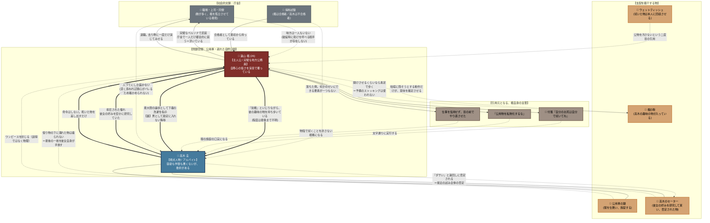

# 🍂 第3章：秋 人間関係・心理力学トポロジー

第3章「秋」（主人公：遠山 楓／視点：高木 圭）における**「支配権の逆転力学」「非対称な侮辱と復讐」「体面と孤立の心理境界」**を有向グラフとして整理した相関図です。

> [!info] 全面改訂（2026-08-23）
> 職場（会社 → 役所）、高木の身分（後輩社員 → 採用試験に落ちたアルバイト）、
> 支配の媒介物（車の鍵とウェットティッシュ → 鍵・服・鞄・言葉）、
> そして**関心が双方向であったこと**が判明したため、旧版の相関図は破棄して作り直している。

---

## 1. 人間関係・支配力学相関図 (Mermaid)

---

## 2. 心理力学の構造分析

### ① 「命令なき支配」は、引用によって成立する
高木は一度も直接的な暴力や脅迫を行いません。それどころか**新しい要求を一つも作りません**。彼がすることは、**楓が過去に発した言葉と掲げた規範を、そのまま適用すること**だけです。

だから彼は最後まで正しく、最後まで親切の顔でいられます。**命じる必要がないからこそ、命じないという形が成立している**——性格ではなく方法です。

### ② 支配は物を経由する（触れずに所有する）
高木は、クライマックスまで楓に手を触れません。にもかかわらず支配は完成します。媒介するのは**鍵・服・鞄**という物です。

* **鍵** — ワンピースを公用車に施錠する。**説得ではなく物理が塞ぐ**
* **セーター** — 借り物の下に濡れた物は着られない。**最後の一枚を彼女自身が手放す**。しかも**彼の服が彼女の全身に接している**
* **鞄** — 開けさせたくない物があるために、備えていた予備のストッキングが使えない

**被覆の主導権が彼女から彼へ移る**ことが、この章における「所有」の実体です。

### ③ 譲歩の非対称着弾（侮辱のすれ違い）
- **楓の認識**: 完璧主義を砕き、後輩に下着を洗わせるという「身を切る最大の譲歩」
- **高木の実感**: 「**男として全く勘定に入れられていない**」という最大の侮辱

この認知のズレが着火点です。ただし最初に来るのは怒りではなく**幻滅**——憧れの対象が落ちたことへの落胆であり、そこから形のない反感を経て、ようやく自覚された復讐に至ります。

### ④ 鏡像 — 同じ関心が、同じ形で否定されていた
| | 高木 | 楓 |
| :--- | :--- | :--- |
| **したこと** | 楓の好みを研究し、寄せた物を買った | 高木の趣味の物を持ち歩いていた |
| **相手の反応** | 遠回しに「ダサい」と否定された | 「幼稚」だといじっていた |
| **知られたか** | 研究していたことは知られていない | 持っていたのを隠そうとした |

**認められない関心は双方向でした。** 高木は復讐の最中に鞄の中身を見てそれに気づきますが、**確証はなく、確かめる手段も永久にありません。**

### ⑤ 檻は、加害者にも架かっている
高木は復讐を遂げ、次の試験に受かり、彼女の抜けた席に座ります。それでも——

* 楓が自分をどう思っていたのかは分からない
* 楓がどこまで立ち直ったのかも分からない（人づてにしか届かず、深く尋ねれば関心がバレる）

**支配は完了しているのに、何一つ手に入っていない。** 第3章が「逆転劇」ではなく「途絶と記憶」の話である理由がここにあります。

---

## 3. 関連

* [[characters/kaede/index|遠山 楓]]／[[characters/takagi/index|高木 圭]]
* [[chapters/03-autumn/index|第3章：秋]]／[[chapters/03-autumn/plot-topology|📐 プロットトポロジー]]
* [[chapters/03-autumn/insert|📎 末尾インサート②：秘書「やすみ」による客観処理]]（楓本人の章には登場しない）
* [[locations/campsite-mud|📍 寂れた自然公園・トイレ棟の前]]
