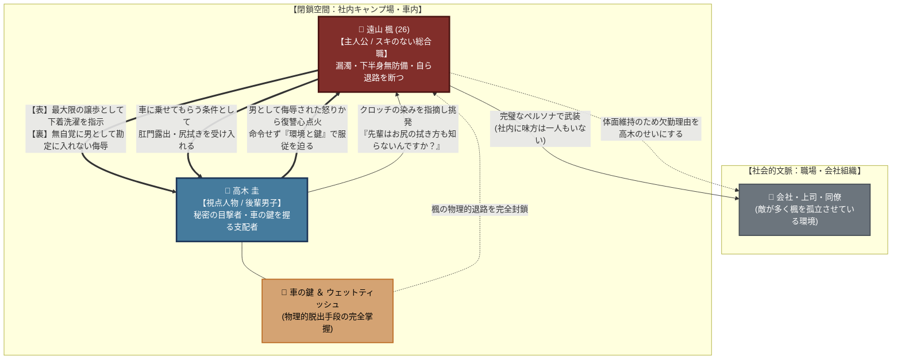

# 🍂 第3章：秋 人間関係・心理力学トポロジー

第3章「秋」（主人公：遠山 楓／視点：高木 圭）における**「支配権の逆転力学」「非対称な侮辱と復讐」「体面と孤立の心理境界」**を有向グラフとして整理した相関図です。

---

## 1. 人間関係・支配力学相関図 (Mermaid)

---

## 2. 心理力学の構造分析

### ① 「命令なき支配」の成立
高木は一度も直接的な暴力や脅迫を行いません。**「車の鍵を持つ」「服の選択肢を奪う」「内側からドアをロックする」**という環境・物理リソースの掌握を通じて、楓自身に「屈辱を受け入れる」選択を自発的に取らせるという、冷徹な支配トポロジーが描かれています。

### ② 譲歩の非対称着弾（侮辱のすれ違い）
- **楓の認識**: 完璧主義のプライドを砕き、後輩男子に下着を洗わせるという「身を切る最大の譲歩」。
- **高木の実感**: 「自分は男として全く意識すらされていない（道具・無性別として扱われた）」という「最大の侮辱」。
この認知のズレが、静かな復讐劇の決定的な着火点となっています。
