# ❄️ 第4章：冬 プロットトポロジー（DAG依存関係分析）

本ドキュメントは、第4章「冬」（主人公：橘 柊）における**原体験への執着 → 三重の下方修正 →
自発的露出 → 前提の破棄 → 逃走**という展開を、有向非巡回グラフ（DAG / トポロジカル構造）
として体系化したプロット設計書です。

---

## 1. 物語トポロジー依存関係図 (Mermaid)

```mermaid
flowchart TD
    classDef situation fill:#8E99A4,stroke:#495057,stroke-width:2px,color:#fff;
    classDef choice fill:#d4a373,stroke:#bc6c25,stroke-width:2px,color:#000;
    classDef retreat fill:#adb5bd,stroke:#6c757d,stroke-width:2px,color:#000;
    classDef psychLock fill:#457b9d,stroke:#1d3557,stroke-width:2px,color:#fff;
    classDef climax fill:#e63946,stroke:#9b2226,stroke-width:2px,color:#fff;
    classDef evidence fill:#2a9d8f,stroke:#1d6f65,stroke-width:2px,color:#fff;
    classDef endBeat fill:#6a0dad,stroke:#3c096c,stroke-width:2px,color:#fff;

    %% ==========================================
    %% Phase 0: 原体験
    %% ==========================================
    subgraph Phase0_Origin ["【Phase 0：原体験（断片としてのみ想起）】"]
        Origin(["小学校時代・幼馴染 美雨の失禁<br/>事後処理を『ある大人』の作為で目撃させられる"]):::situation
        Thanatos["【核】証明したい願望 ⇄ 曝け出して楽になりたいタナトス<br/>動機の最終形＝『解放され、庇護されたい』"]:::psychLock
        Origin --> Thanatos
    end

    %% ==========================================
    %% Phase 1: 準備
    %% ==========================================
    subgraph Phase1_Preparation ["【Phase 1：私室での準備 — 口実の設計】"]
        Thanatos --> ImpulseBuy["児童服店で児童用下着を衝動買い<br/>(美雨のものと酷似・実践の足がかり)"]:::choice
        ImpulseBuy --> Hydration["意図的な大量の水分摂取<br/>【冬だけ、飲食が因果の起点になる】"]:::choice
        Hydration --> TwoOutfits["二着の衣装を設計<br/>大人モードで入園 → 園内で子供モード五層へ着替え"]:::choice
        TwoOutfits --> LongShirt["丈の長いチェックシャツを選ぶ<br/>【汚して脱がせてもらうための計算】"]:::choice
        TwoOutfits --> KeyHidden["ロッカーの鍵を首から下げ<br/>胸つぶしの中＋マフラーで三重に隠す"]:::choice
    end

    %% ==========================================
    %% Phase 2: 三重の下方修正
    %% ==========================================
    subgraph Phase2_Retreats ["【Phase 2：三重の下方修正 — 自発は英断ではない】"]
        LongShirt --> Retreat1
        KeyHidden --> Retreat1["後退①：絶叫マシン → 観覧車<br/>(乗る勇気が出ない。『ダサい』と自覚)"]:::retreat
        Retreat1 --> Retreat2["後退②：ゴンドラ内で出せない<br/>(緊張・迷惑への恐怖＝観覧車が止まるかも)"]:::retreat
        Retreat2 --> Decision["降車直後、待機列の前で決意<br/>【失敗の連続の果ての、追い詰められた決断】"]:::psychLock
    end

    %% ==========================================
    %% Phase 3: 4段階のクライマックス
    %% ==========================================
    subgraph Phase3_Climax ["【Phase 3：自発露出と4段連鎖】"]
        Decision --> Step1["★ 段階①【自発的排尿】待機列の群衆の前<br/>湯気が立ち、全員に見える<br/>(やってしまった恐怖＝第1ピーク)"]:::climax

        Step1 --> Induce["【誘導】『じぶんでできません』の演技<br/>要求せず、動かないことで脱がせる"]:::choice
        Induce --> Step2["★ 段階②【願望達成】小鳥遊が下着を脱がせ、拭く<br/>(バケットリストの達成・真の羞恥ではない)"]:::choice

        Step2 --> CarRefill["【車内のやり足し】小鳥遊が敷いたタオルの上で二度目<br/>一度目は演技、二度目は実行。誰にも気づかれない"]:::choice
        CarRefill --> Wait["楽屋で半裸のまま待機<br/>(時間は悪意ではなく『手続き』が作る)"]

        Wait --> Receipt["レシート（時刻入り）"]:::evidence
        Receipt --> Camera["監視カメラ：出てくる姿はあるのに入る姿がない"]:::evidence
        Camera --> KeyDemand["誰も『出せ』と要求しない<br/>正規の手続きを二つ並べる or ただ待つ"]:::evidence
        KeyDemand --> KeySurrender["柊が自分から鍵を差し出す<br/>【隠していた事実が故意の証明になる】"]:::evidence

        KeySurrender --> Step3["★ 段階③【前提の明示的な破棄】<br/>『あなた、本当は大人ですよね？』<br/>全員が大人と認識した上で『この場で脱いでください』"]:::climax
        Step3 --> SelfStrip["二度目は柊自身の手で脱ぐ<br/>【されたい人間にとって、最も正確な願望の否定】"]:::climax
        SelfStrip --> Rabbit["ウサギの着ぐるみ（交代制）が単独で訪れる<br/>庇護の完成形に見えて、中身は男性だと気づく"]:::climax
        Rabbit --> Taboo["課されるタブー：秘部の開陳／下半身剥き出しの楽屋歩行／<br/>『うさぎと写真撮りたいよね？』＝半強要の撮影<br/>【彼女がついた嘘が、彼女を裸で歩かせる】"]:::climax

        Taboo --> MufflerLost["マフラーを失う（理由は `open`）"]
        MufflerLost --> Step4["★ 段階④【逃走のタブー】顔を隠すため上衣を引き上げ<br/>顔以外の全部を晒したまま駐車場を駆け抜ける"]:::climax
    end

    %% ==========================================
    %% Phase 4: 事後（章の主眼）
    %% ==========================================
    subgraph Phase4_Aftermath ["【Phase 4：事後 — 章の主眼はここにある】"]
        Step4 --> AdultUnderwear["大人用下着を自分の手で身につける<br/>【恥辱がない。それが恥辱】"]:::endBeat
        AdultUnderwear --> Kotatsu["炬燵で身を隠す<br/>視覚的には隠れ、体感的には露出している"]:::endBeat
        Kotatsu --> Cold["興奮が過ぎ去った後の惨めさ<br/>濡れた布は乾く過程でさらに体温を奪う"]:::endBeat
        Cold --> OpenEnding["欲求が満たされた後どうなったかは<br/>語られずに幕を閉じる"]:::endBeat
    end

    %% 通し矢印：口実の再利用
    Induce -.->|"『未熟な子供だから後処理もできません』<br/>この口実が、段階③で加害側に引用される"| Taboo
    LongShirt -.->|"濡れが不十分だと判明したため"| CarRefill
    KeyHidden -.->|"上半身を死守する動機になり、<br/>その死守が鍵の在処を教える"| KeySurrender
```

---

## 2. 物語のトポロジカル進行フェーズ表

| フェーズ | 舞台 | 主人公（柊）のアクション / 心理 | トポロジー機能 |
| :--- | :--- | :--- | :--- |
| **Phase 0** | （断片としての記憶） | ・美雨の事後処理を目撃させられた原体験 ・ショック・恐怖・願望のないまぜ | **執着の形成／二重性の起点** |
| **Phase 1** | 児童服店・私室 | ・児童用下着の衝動買い ・意図的な水分摂取 ・二着の衣装と鍵の隠匿を設計 | **口実の設計（自発性の物的証明）** |
| **Phase 2-①** | 絶叫マシンの列 | ・乗る勇気が出ず離脱 | **後退①：再演の精度が落ちる** |
| **Phase 2-②** | 観覧車のゴンドラ | ・緊張と迷惑への恐怖で出せない | **後退②：計画の完全な不成立** |
| **Phase 2-③** | 降車口・待機列前 | ・追い詰められた末の決意 | **自発的不可逆フラグの起動** |
| **Phase 3-①** | 観覧車待機列 | ・群衆の前で排尿。湯気が立つ | **第1ピーク（恐怖）／可視化** |
| **Phase 3-②** | スタッフ前・園内の車 | ・演技で誘導し、脱がせ、拭かせる ・車内で「やり足す」 | **願望の達成／異常性の露呈** |
| **Phase 3-③** | 楽屋（仕切りなし） | ・レシートとカメラで正体が割れる ・自分から鍵を差し出す ・前提を破棄され、自分の手で脱ぐ | **真の羞恥ピーク／誘導権の喪失** |
| **Phase 3-④** | 楽屋 → 駐車場 | ・顔を守るため身体を全部渡して逃走 | **限界突破と逃走** |
| **Phase 4** | 事後 | ・大人用下着を自分で着る ・炬燵で身を隠す | **章の主眼：観客の解散後に腐る羞恥** |

---

## 3. 構造的強度

### ① 「自発」ノードに、成功した親が一つもない

段階①（自発的排尿）へ入る経路は、**すべて後退である**。絶叫マシンを降り、ゴンドラで
出せず、迷惑を恐れて諦めた——**この章の最も能動的な行為が、三つの失敗だけを親に持つ。**
柊は再演の主体でありながら、再演の設計通りには何一つできていない。

### ② 口実が、加害側へ引用される（点線の逆流）

段階②で柊が使った口実「未熟な子供だから自分で後処理もできません」は、段階③で
**加害側に引用される**。子供なら下半身を出して歩いても構わない、子供なら写真を撮っても
構わない。**彼女が用意した言い訳が、彼女を裸で歩かせる。**

第3章（楓自身の言葉を高木が実行する）と**同型**であり、違いは引用元だけ——
**第3章は他人の言葉、第4章は自分がついた嘘。**

### ③ 防御の設計が、そのまま証拠の設計になっている

鍵を三重に隠したのは合理的だった。だがそれは同時に、
**上半身を死守する動機**を生み、**その死守が鍵の在処を教える。**
そして隠していたという事実自体が**故意の証明**になる。
防御ノードから証拠ノードへ、点線が一本通っている。

### ④ 加害ノードに、明示的な主体が置かれていない

Lv.2（ふざけ）という設定上、**一人の積極性に周囲が半受動的に従うだけ**であり、
集団として企図された加害は存在しない。**事後の自覚は「そんなつもりじゃなかった」。**
責任が宙に浮いたまま終わる。

段階的なエスカレーションにすると第3章の高木と同型になるため、
**冬はカーブではなく「もつれ」**——統制されないまま同時多発する形で書く。

### ⑤ 終端が climax ではなく aftermath にある

DAGの最終盤に置かれているのは逃走ではなく、**大人用下着を自分で着る**ことと
**炬燵で身を隠す時間**である。**羞恥には観客が要る。観客が解散した後の羞恥は、
行き場がないまま自分の中で腐る。** 章の主眼はこの区間にあり、紙幅配分もこれに従う。

### ⑥ 二つの発覚が、時間差で置かれている

一つ目は「大人である」こと。二つ目は「**それ、ずっとそこに入れてたの？**」——
鍵の隠し場所である。鍵の提出自体は脱衣の理由にならない（襟元から引き上げれば出る）ため、
**二つ目の発覚は独立したビートとして機能する。**

---

## 4. `open` — この図が確定できていない箇所

* **上半身が脱げる経路**（段階③の開始条件）。図では `SelfStrip` の前提として省略している
* **マフラーを失う理由**（段階④の成立条件）。`MufflerLost` ノードは理由未定のまま置いてある。→ 2026-10-12 作者指定：マフラーを掴まれ、振り解いて逃げる（[[chapters/04-winter/index|index]]末尾）。マフラーは相手の手に残り、柊は失う（作者指定）
* **三つの着地**（α未遂／β間に合わない／γ女子が男子を追い出す）。採る着地によって
  `Rabbit` と `Taboo` の順序が変わる。→ 2026-10-12 作者指定：β を採る（[[chapters/04-winter/index|index]]末尾）
* **「もっと狂気に満ちた行動」** が `Step4` と別ノードなのか同一なのか
* **非時系列構成案**を採る場合、この DAG は依存関係図として残り、
  **語り順とは別物になる**
