# ❄️ 第4章：冬 プロットトポロジー（DAG依存関係分析）

本ドキュメントは、第4章「冬」（主人公：橘 柊）における物語展開、過去のトラウマへの執着、自発的な露出への跳躍、および4段階に連なるクライマックス構造を有向非巡回グラフ（DAG / トポロジカル構造）として体系化したプロット設計書です。

---

## 1. 物語トポロジー依存関係図 (Mermaid)

```mermaid
flowchart TD
    classDef situation fill:#8E99A4,stroke:#495057,stroke-width:2px,color:#fff;
    classDef choice fill:#d4a373,stroke:#bc6c25,stroke-width:2px,color:#000;
    classDef trap fill:#e76f51,stroke:#f4a261,stroke-width:2px,color:#fff;
    classDef psychLock fill:#457b9d,stroke:#1d3557,stroke-width:2px,color:#fff;
    classDef climax fill:#e63946,stroke:#9b2226,stroke-width:2px,color:#fff;
    classDef endBeat fill:#6a0dad,stroke:#3c096c,stroke-width:2px,color:#fff;

    Start(["導入：過去の記憶への強烈な執着<br/>(小学生時代の少女の失禁・事後処理を目撃)"]):::situation

    %% ==========================================
    %% Phase 1: 執着の深化と私室での準備
    %% ==========================================
    subgraph Phase1_Preparation ["【Phase 1：反転願望と私室での足がかり】"]
        Start --> ImpulseBuy["児童服店で児童用下着を衝動買い<br/>(かつての少女のものと酷似)"]:::choice
        ImpulseBuy --> RoomPreparation["私室での準備・実行への決意<br/>【目撃者から当事者への反転（再演）願望】"]:::psychLock
        RoomPreparation --> MoveAmusementPark["遊園地へ向かう（観覧車へ搭乗）"]
    end

    %% ==========================================
    %% Phase 2: 4段階のクライマックス
    %% ==========================================
    subgraph Phase2_FourStepsClimax ["【Phase 2：自発露出と4段連鎖の破綻】"]
        MoveAmusementPark --> Step1_Urination["★ 段階①【自発的排尿】：観覧車降車直後<br/>待機列の群衆の前で下着の中に排尿する<br/>(やってしまった恐怖と第1ピーク)"]:::climax
        
        Step1_Urination --> Step2_WishFulfilled["★ 段階②【願望達成】：子供のフリをして<br/>女性スタッフ（小鳥遊）に濡れた下着を脱がせてもらう<br/>(バケットリストの達成・まだ真の羞恥ではない)"]:::choice
        
        Step2_WishFulfilled --> Step3_TrueShame["★ 段階③【真の羞恥ピーク】：大人の女という欺瞞が発覚<br/>ウサギの着ぐるみ・小鳥遊による悪意の制裁<br/>(足首固定・とある行為の半強要)"]:::climax
        
        Step3_TrueShame --> Step4_TabooEscape["★ 段階④【逃走のタブー】：逃げ出すために<br/>『女性としての最大のタブー』を犯す"]:::climax
    end

    %% ==========================================
    %% Phase 3: 欲求充足の宙吊り
    %% ==========================================
    subgraph Phase3_Aftermath ["【Phase 3：結末の宙吊り】"]
        Step4_TabooEscape --> OpenEnding["柊の欲求が満たされた後<br/>どうなったかは語られずに幕を閉じる"]:::endBeat
    end
```

---

## 2. 物語のトポロジカル進行フェーズ表

| フェーズ | 舞台 | 主人公（柊）のアクション / 心理 | トポロジー機能 |
| :--- | :--- | :--- | :--- |
| **Phase 1** | 私室・児童服店 | ・過去の目撃体験の「再演」を渇望 ・児童用下着を購入し準備を整える | **自発的動機の形成（目撃者から当事者へ）** |
| **Phase 2-①** | 観覧車待機列 | ・自らの意志で群衆の前で排尿を実行 | **自発的不可逆フラグの起動** |
| **Phase 2-②** | 遊園地スタッフ前 | ・「子供の演技」でスタッフ（小鳥遊）に下着を脱がせてもらう | **個人的バケットリスト（願望）の達成** |
| **Phase 2-③** | 閉鎖空間 | ・大人の女という欺瞞が露見し悪意を呼び込む ・ウサギの着ぐるみ等による事務的拘束と行為強要 | **欺瞞の暴発と真の羞恥ピーク** |
| **Phase 2-④** | 逃走劇 | ・最大のタブーを犯して脱出 | **限界突破と逃走** |
