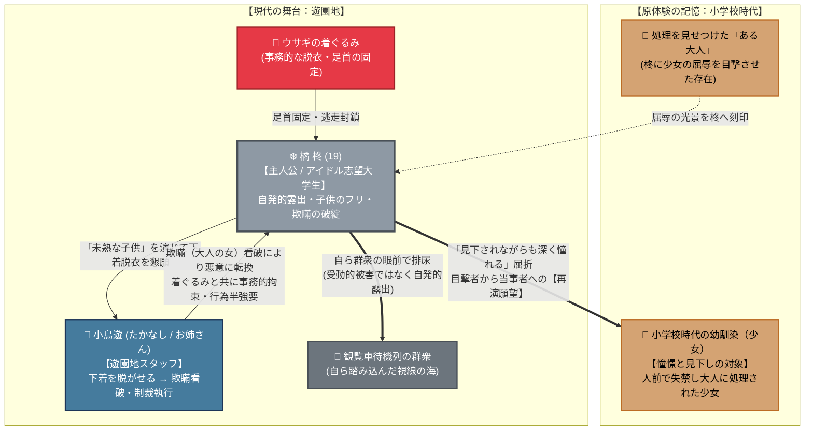

# ❄️ 第4章：冬 人間関係・心理力学トポロジー

第4章「冬」（主人公：橘 柊）における**「過去の少女への執着・再演動機」「欺瞞（子供の演技）と制裁の力学」「視線の受動から自発への転換」**を有向グラフとして整理した相関図です。

---

## 1. 人間関係・心理力学相関図 (Mermaid)

---

## 2. 心理力学の構造分析

### ① 他者体験の「再演（Reenactment）」という特異なトポロジー
他の章（桃香・向日葵・楓）が「予期せぬ事故や他者の悪意によって受動的に破綻させられる」のに対し、柊だけは**「かつて他人が受けた屈辱の儀式を、自らの肉体で完全にトレース（再演）したい」**という歪んだ自発的動機から始まります。

### ② 欺瞞（子供のフリ）が呼び込む悪意の反作用
- **願望段階**: 「子供だから処理できない」という演技が通じている間は、単なるバケットリストの達成に過ぎない。
- **破綻段階**: 「大人の女が子供のフリをして脱がせてもらおうとしていた」という**欺瞞の発覚そのものが、スタッフ（小鳥遊・着ぐるみ）の冷酷な悪意と制裁を呼び込む**という因果応報のトポロジーになっています。
