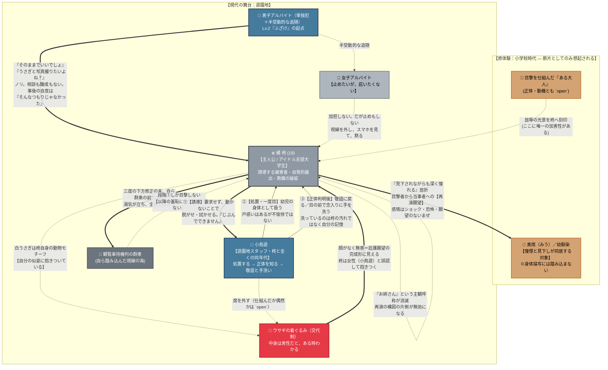

# ❄️ 第4章：冬 人間関係・心理力学トポロジー

第4章「冬」（主人公：橘 柊）における**「原体験への執着と再演」「誘導する被害者」
「誰も引き受けない集団の悪意」「前提の破棄による関係の反転」**を有向グラフとして
整理した相関図です。

---

## 1. 人間関係・心理力学相関図 (Mermaid)

---

## 2. 心理力学の構造分析

### ① 誘導する被害者 — 「自発」の二段目

他の3人は処置される側に置かれる（桃香は秘書に処理され、楓は高木に洗わせ、向日葵は
誰にも触れられない）。**柊だけが誘導する。**

* **一段目の自発** — 視線の中へ自ら踏み出す
* **二段目の自発** — **他人に自分を処置させる**

柊は受動の形をした能動を実行しており、**弱さを演じることが手段になっている。**

> [!warning] 書き方の難所
> 誘導が透けると読者は共感できなくなり、隠しすぎると自発性が消える。
> **本人の自覚は半分にする**——願望であることは自覚しているが、自分がどれだけ巧妙に
> 仕向けているかは自覚していない。第2章の向日葵（演者であることに無自覚）と同じ配分。

**そして誘導は途中で破綻する。** 段階③で正体が露見した後は、彼女の意図しない方向へ
処置が進む。**誘導できていたのは、正体がバレるまでである。**

### ② 小鳥遊 — 加害を望まないまま、柊を最も深く壊す人物

小鳥遊は**柊と全くの同年代**である。年長者ではない。「お姉さん」は柊の主観にすぎず、
**対等であるはずの相手に処理されること**が屈辱を強める。

彼女は**正体が露見する前からすでに動揺している**——脱がせるほどに身体つきの意外な
大胆さへの羞恥を伴う戸惑いがあり、拭くために至近距離で見たショックもあった。
正体を知った後、**一度目に見た細部の記憶が遡って別の意味になる。**

| | 一度目 | 二度目 |
| :--- | :--- | :--- |
| **柊をどう見ているか** | 幼児の身体 | **同年代の女の身体** |
| **言葉** | ため口。手続きの言葉を挟まない | **「失礼します」を挟まないと触れない** |
| **視線** | 無防備 | **見ないようにしながら見る** |
| **呼称** | （子供扱い） | **「お客様」** |

> [!important] 彼女は何一つ責めていない
> 敬語も手洗いも、**嫌悪の表明であると同時に「なかったことにする」ための手続き**である。
> 片方は言葉、片方は動作。**何一つ責められていないのに、柊は一方的に恥ずかしい。**

### ③ 悪意の主体が存在しない — Lv.2「ふざけ」

**一人の積極性に、周囲が半受動的に従うだけ**であり、集団として企図された加害は存在しない。
大学生のアルバイトたちには**相談する場所も、悪意を醸成する時間も、敵対を確認し合う時間もない。**

| 章 | 加害者の形 |
| :--- | :--- |
| ☀️ 夏 | **与えられない**（顔のない手） |
| 🍂 秋 | **顔のある単独犯**（高木圭） |
| ❄️ 冬 | **誰も引き受けない集団** |

**柊にとってこれが最も残酷である。** 憎まれるのでも無視されるのでもなく、
**玩具として扱われる。** 彼女は「解放され、庇護されたい」と願って来た。
**叶ったものと叶わなかったものが、同じ場所で混ざる。**

### ④ 女子アルバイト — 嫌悪のベクトルは、排除であって拘束ではない

気持ち悪いものは遠ざけたい。**目の前に置いておきたくない。留めて剥がすのは、興味が
ある人間の行動である。**「ざまあみろ」は一言嫌味を言えば済み、**裸にする必要がない。**

止めない理由は、**止めるには場の空気に逆らう必要があり、しかも気持ち悪いと思っている
相手を庇う形になる**から。**「止めたいが、庇いたくない」で宙吊りになり、黙る。**

> [!note] 加担も制止もしない身体を描く
> 視線を外す、スマホを見る、その場から意識だけ抜く。
> **居心地の悪さが可視化されているのに、誰も動かない。**

### ⑤ 着ぐるみ — 無防備さの根拠が、そのまま罠になる

顔がなく、無害で、可愛くて、動物。**柊が求めた「庇護されること」の完成形に見える。
だから彼女は無防備になれる。** そして中身は男性だった。

**白うさぎは柊自身の動物モチーフである。** 彼女は自分と同じ形をした存在に抱きついて
いる——**再演の相手が自分の似姿だった**という構図は、「目撃者から当事者への反転」と
いう章の主題と重なる。**偶然のまま置いておくほうが不気味**かもしれない。

### ⑥ 目撃者と被目撃者が、一人に畳まれる

他の章では目撃者と失禁者が**別人**である（第1章＝秘書と桃香、第3章＝高木と楓）。
**第4章だけは、その二つが一人の中に畳まれる。** 柊は「かつての目撃者」であり
「これから見られる者」でもある。

これにより、柊が過去の残響に囚われているという性格描写が、そのまま構造の説明にもなる。

---

## 3. `open` — 未決の関係

| 項目 | 内容 |
| :--- | :--- |
| **着ぐるみは仕組まれたか** | 仕組まれたなら小鳥遊が段階③の悪意の主体になり「席を外す」が伏線になる。偶然なら悪意は誰のものでもなくなり、第2章に近づく |
| **小鳥遊は車内の件を後で知るか** | 知れば嫌悪に具体的な座標が生まれる（「私が敷いたタオルの上で」）。知らなければ**読者だけが、誰も追いつかない醜さを知っている**ことになる |
| **小鳥遊の弧** | 胸つぶしを解く役を押し付けられる → 止めに入るが「この人、そういうの喜ぶんだよ」と願望を暴露してしまう → 誰も追わない中で一人だけ見送る。**三度とも、加害を望まないまま柊を壊す** |
| **三つの着地** | α 未遂／β 間に合わない／γ 女子が男子を追い出す（**保護の形をした暴露**）。γを採ると着ぐるみと撮影を後段へ回す必要がある |
| **『ある大人』** | 美雨の事後処理を柊に目撃させた人物。正体・動機とも未詳 |
| **美雨の再登場** | 現在どうしているかは未詳。再登場させるかも未決（「お姉さん」＝小鳥遊が美雨本人でないことは確定） |
