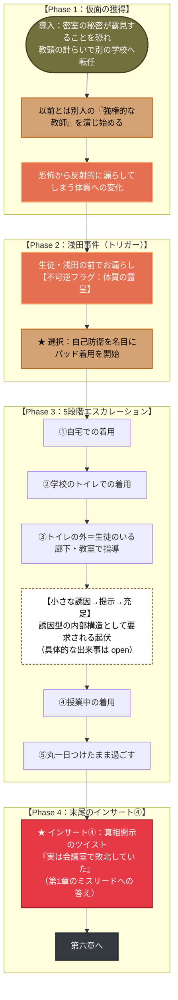

# ✨ 第5章前編：再び春 プロットトポロジー（DAG依存関係分析）

本ドキュメントは、第5章前編（主人公：田邊 桃香）における仮面の獲得、体質の露呈、
5段階エスカレーション、末尾のツイストを有向非巡回グラフ（DAG）として体系化した
プロット設計書です。**外面的には「第五章」の前半として提示しますが、後半＝
[[chapters/05-re-spring/5b-back|第六章]] はファイルを分けています。**

---

## 1. 物語トポロジー依存関係図 (Mermaid)

---

## 2. 物語のトポロジカル進行フェーズ表

| フェーズ | 舞台 | 桃香のアクション／心理 | トポロジー機能 |
| :--- | :--- | :--- | :--- |
| **Phase 1** | 転任先の学校 | 教頭の計らいで転任し、強権的な教師の仮面を被る | 仮面の獲得。第1章の潔癖さとの対比構造 |
| **Phase 2** | 教室 | 浅田の前で恐怖性の失禁を目撃される | 不可逆フラグ（体質の露呈）の起動 |
| **Phase 3** | 学校内各所 | パッドからおむつへ、5段階のエスカレーション | 段階的な自壊。誘因型の内部構造として、途中に小さな起伏が要求される（`open`） |
| **Phase 4** | （末尾） | インサート④で「実は敗北していた」と開示される | 再誘因の終着点＝新誘因。第1章のミスリードを回収するツイスト |

> [!warning] `open` — Phase 3の内部にある「小さな起伏」の具体
> [[rules/triad-structure]] セクション5の規則により、誘因型（第1章・第5章前編）の
> 内部には完結した小さな誘因→提示→充足が一つ埋め込まれるべきとされている
> （[[cpt-2c91]]）。5段階のどこかに置く想定だが、具体的な出来事は未定。
