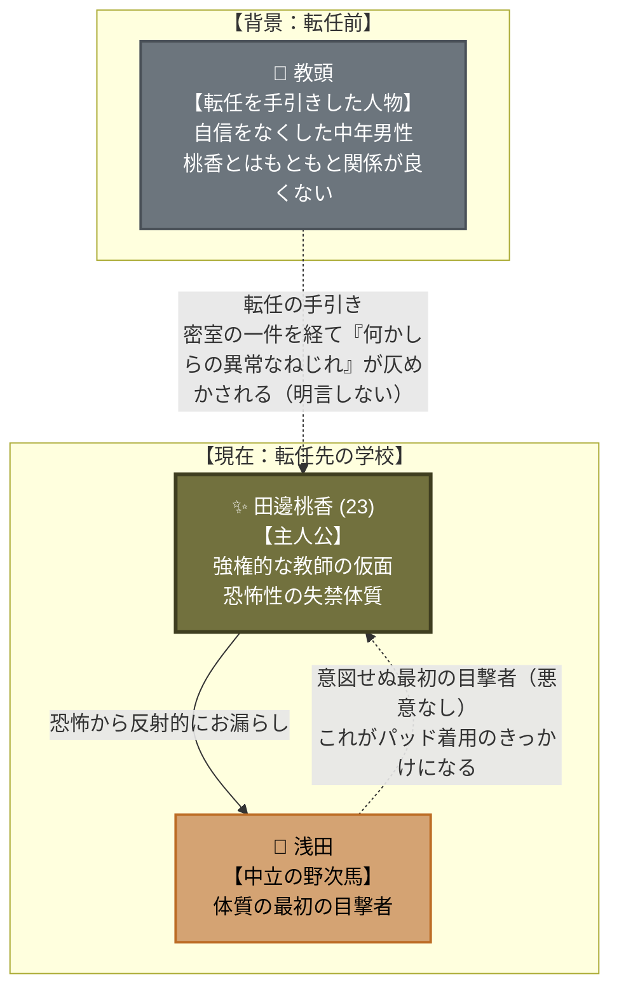

# ✨ 第5章前編：再び春 人間関係・心理力学トポロジー

第5章前編（主人公：田邊 桃香）における**「転任の手引きと仄めかされた歪み」
「体質の最初の目撃者」**を有向グラフとして整理した相関図です。

---

## 1. 人間関係・心理力学相関図 (Mermaid)

---

## 2. 心理力学の構造分析

### ① 桃香 ⇄ 教頭（仄めかされた歪み）

第1章の密室の一件を隠すため、教頭の計らいで転任する。二人の関係はもともと
「自信をなくした中年男性」と「今を生きる若い女性」という対比の中にあり、事件後
密室下で何らかの異常なねじれが生じたことが仄めかされるが、意図的に明言されない
（[[cpt-71fa]]）。この不透明さ自体が、桃香の転任という選択の不気味さを支える。

### ② 桃香 ⇄ 浅田（無自覚な目撃者）

浅田は加害の意図を持たない中立の生徒。桃香の新しい体質（恐怖からの反射的な失禁）を
最初に目撃する存在であり、この一件が自己防衛を名目にしたパッド着用のきっかけに
なる。浅田自身がその後の物語にどう関わるかは `open`。
