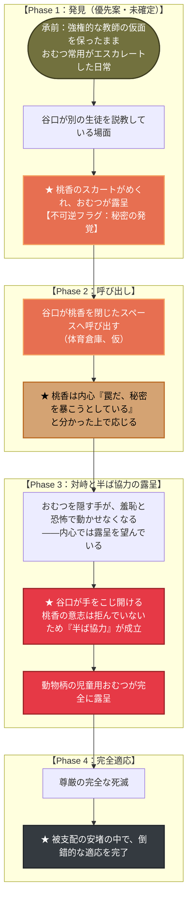

# 🌸 第六章：再び春・後編 プロットトポロジー（DAG依存関係分析）

本ドキュメントは、第六章（主人公：田邊 桃香）における発見・呼び出し・対峙・完全適応を
有向非巡回グラフ（DAG）として体系化したプロット設計書です。インサートを持たない、
経糸の終着点にあたるエピソードです。

---

## 1. 物語トポロジー依存関係図 (Mermaid)

---

## 2. 物語のトポロジカル進行フェーズ表

| フェーズ | 舞台 | 桃香のアクション／心理 | トポロジー機能 |
| :--- | :--- | :--- | :--- |
| **Phase 1** | 教室など | スカートがめくれ、おむつが露呈する（優先案） | 秘密発覚の不可逆フラグ（`open`・留保） |
| **Phase 2** | 校内 | 谷口に呼び出される。罠と分かった上で応じる | 抵抗の放棄。「自ら罠に踏み込む」という第4章（柊）との共鳴 |
| **Phase 3** | 閉じたスペース | 手が動かせなくなる→こじ開けられる→完全露呈 | 「半ば協力」——強制でも自発でもない第三の機構（[[cpt-3a76]]） |
| **Phase 4** | 同 | 尊厳死滅、被支配の安堵 | 経糸の終着点。第1章と対をなす完全適応 |

> [!warning] `open` — Phase 1の発見経緯は留保
> スカートめくれ説を優先案としているが、前の学校からの噂・浅田による漏洩という
> 代替案も残っている（[[cpt-6d5c]]）。
