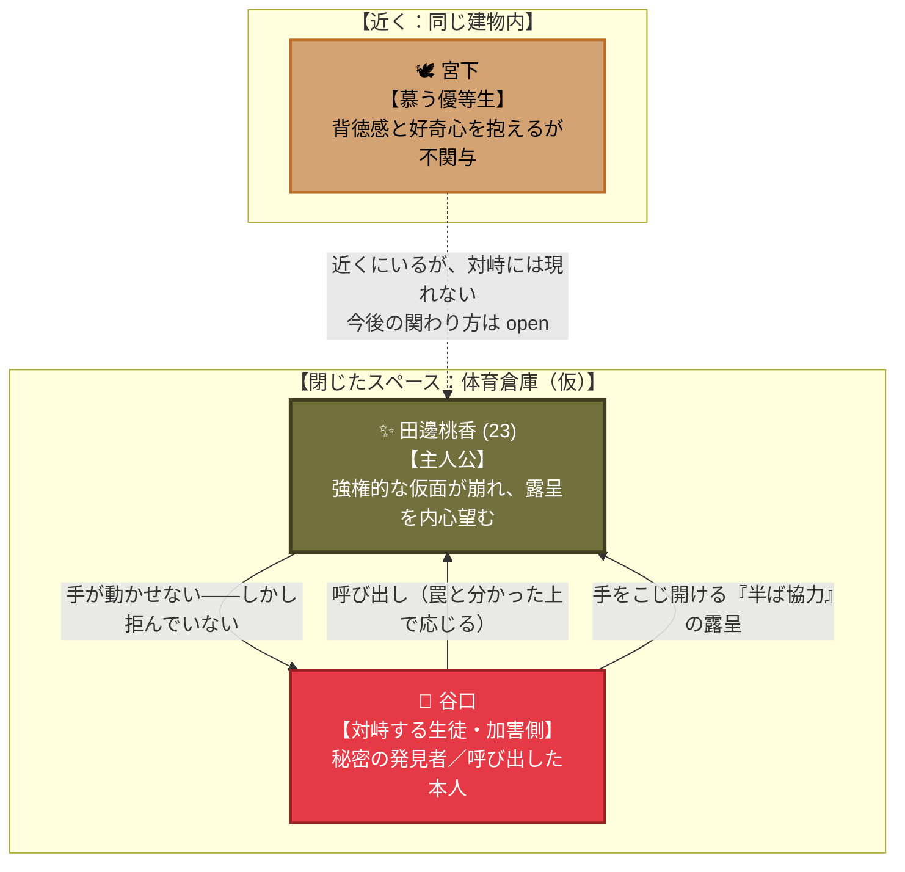

# 🌸 第六章：再び春・後編 人間関係・心理力学トポロジー

第六章（主人公：田邊 桃香）における**「加害者との半ば協力の露呈」「近くにいて
関与しない優等生」**を有向グラフとして整理した相関図です。

---

## 1. 人間関係・心理力学相関図 (Mermaid)

---

## 2. 心理力学の構造分析

### ① 桃香 ⇄ 谷口（半ば協力の露呈）

谷口は一度も直接「見せろ」と命令しない——呼び出すことと、こじ開けることだけを行う。
桃香の側も「罠だ」と分かった上で応じ、手も本心では拒んでいない。**強制と自発が
同時に真である**という、他の3人（楓・柊）とも異なる第三の機構（[[cpt-3a76]]）。

### ② 桃香 ⇄ 宮下（不在の目撃者候補）

宮下は対峙の場に現れないが、**完全に無関係などこかにいるわけでもない**——同じ
建物内、あるいは直後に居合わせる可能性がある「近さ」を保つ。この人物が今後どう
物語に効いてくるかは、経糸の外側に残された数少ない伏線の一つ。
